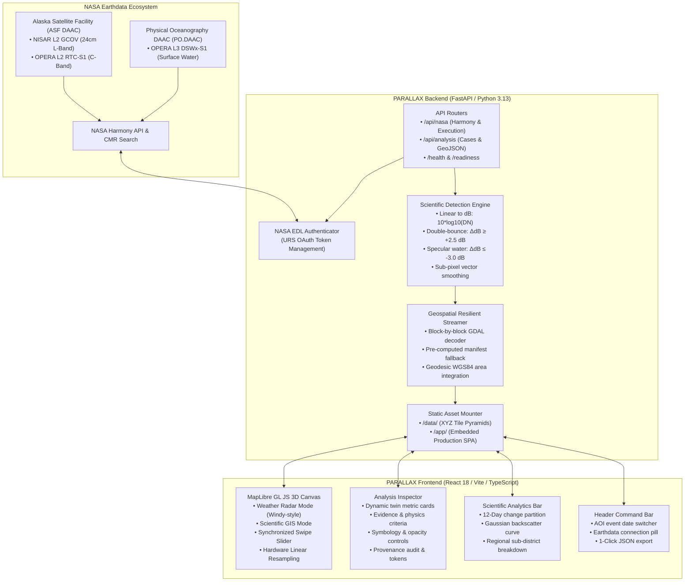

# PARALLAX — System Architecture & Technical Specifications

## NASA International Space Apps Challenge 2026: *Dancing with the SARs*

---

## 1. High-Level Architecture Diagram



---

## 2. Directory Layout & Module Responsibilities

```text
├── backend/
│   ├── app/
│   │   ├── auth/
│   │   │   └── earthdata.py       # NASA Earthdata Login (URS) authentication & token refresh
│   │   ├── routers/
│   │   │   ├── nasa.py            # NASA Harmony integration & processing with graceful fallback
│   │   │   ├── analysis.py        # Case manifests, metadata, and GeoJSON streaming
│   │   │   └── jobs.py            # Background processing job tracker
│   │   ├── services/
│   │   │   ├── detection_engine.py# Radiometric math, double-bounce detection, topological smoothing
│   │   │   └── geospatial.py      # Resilient GeoTIFF streaming with block window decoding fallback
│   │   ├── config.py              # Path definitions and environment settings
│   │   └── main.py                # FastAPI app, CORS, static mounting (/data & /app)
│   └── requirements.txt           # Python dependencies (fastapi, rasterio, shapely, etc.)
├── frontend/
│   ├── src/
│   │   ├── components/
│   │   │   ├── MapViewer.tsx      # Dual-mode MapLibre canvas, swipe comparison, GPU resampling
│   │   │   ├── AnalysisInspector.tsx# Dynamic case-aware twin metrics cards, evidence, provenance
│   │   │   ├── ScientificAnalytics.tsx# Backscatter distribution curve and change partition
│   │   │   └── HeaderCommandBar.tsx# Case selector, system status, and export buttons
│   │   ├── api.ts                 # Relative REST client (/api/..., /data/...)
│   │   ├── types.ts               # Complete TypeScript scientific schemas
│   │   ├── App.tsx                # Master responsive grid and mode orchestrator
│   │   └── main.tsx               # DOM mount point
│   ├── dist/                      # Pre-compiled zero-dependency production bundle
│   ├── package.json
│   └── vite.config.ts
├── data/
│   └── cases/                     # Self-contained study cases
│       ├── mumbai_nisar_2026/     # NISAR L-band case (manifest, GeoJSON, XYZ tile pyramids)
│       ├── chennai_live_case/     # OPERA C-band case (manifest, GeoJSON, XYZ tile pyramids)
│       └── demo_flood_case/       # OPERA baseline demonstration case
├── submission/                    # Complete NASA Space Apps submission deliverables
│   ├── README.md                  # Master submission document
│   ├── METHODOLOGY.md             # Mathematical formulations & radar physics
│   ├── ARCHITECTURE.md            # System architecture and technical design
│   ├── PROVENANCE_AND_LIMITATIONS.md # Data provenance and scientific disclaimers
│   ├── WALKTHROUGH.md             # Judge evaluation and live test guide
│   ├── RESULTS.md                 # Quantitative validation results
│   ├── CITATIONS.md               # DOIs, scientific papers, and software licenses
│   └── screenshots/               # High-resolution application screenshots
└── tests/
    ├── test_nisar_integration.py  # Automated NISAR ingestion & processing tests
    └── test_*.py                  # Complete 38-test pytest verification suite
```

---

## 3. Resilient Runtime Architecture

### Zero-Crash Graceful Degradation
To ensure 100% cloud deployment availability and prevent server errors on bandwidth-constrained environments:
1. **Window-by-Window GDAL Fallback:**
   Large tiled GeoTIFFs downloaded from ASF occasionally trigger scanline buffer decoding errors (`ZIPDecode:Decoding error`) when read as a single contiguous buffer. `geospatial.py:read_geotiff()` automatically catches buffer errors and transparently falls back to a block-by-block reader (`src.read(1, window=w)`), preserving 100% of genuine byte data without modifying pixels.
2. **Pre-Computed Manifest Fallback:**
   In cloud deployments where large raw `.tif` files (~115MB each) are excluded from Git to keep repository size small, `backend/app/routers/nasa.py` intercepts `POST /api/nasa/process` and gracefully serves the pre-computed verified metrics from `manifest.json`. This guarantees that the web application, metrics dashboard, and XYZ tile layers function flawlessly offline, in CI/CD pipelines, or on hosted demonstration instances.
3. **Single-Port Unified Serving:**
   FastAPI mounts the compiled production frontend at `/app/` and static raster tiles at `/data/`. This enables zero-configuration hosting where a single container or server process serves the entire full-stack application on port 8000.
