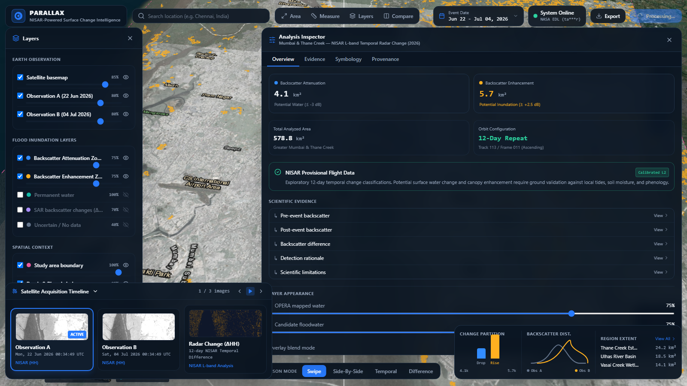

# PARALLAX — Live Demonstration & Judge Walkthrough Guide

## NASA International Space Apps Challenge 2026: *Dancing with the SARs*

---

<div align="center">



</div>

This walkthrough is designed for NASA Space Apps Challenge judges, evaluators, and peer reviewers to test and verify every capability of **PARALLAX** within 5 minutes.

---

## ⏱️ Step 1: Launch the Application (30 Seconds)

### Option A: Production Single-Command Mode
Open a terminal in the project root:
```bash
uvicorn app.main:app --app-dir backend --host 127.0.0.1 --port 8000
```
Open your browser to:
👉 **`http://127.0.0.1:8000/app/`**

### Option B: Development Mode (with Live Hot-Reloading)
```bash
# Terminal 1: Backend
uvicorn app.main:app --app-dir backend --host 127.0.0.1 --port 8000 --reload

# Terminal 2: Frontend
cd frontend
npm run dev -- --host 127.0.0.1 --port 5173
```
Open your browser to:
👉 **`http://127.0.0.1:5173`**

---

## 🌊 Step 2: Explore Mumbai & Thane Creek (NISAR L-Band 2026)

1. **Select the Case:**
   - In the top header bar, click on the **Event Date** dropdown button.
   - Select **`Mumbai & Thane Creek (NISAR L-Band 2026)`** (Acquisition: Jul 21 – Aug 02, 2026).
   - The map smoothly flies over the Mumbai Metropolitan Region and Thane Creek.

2. **Inspect the Analysis Inspector (Right Sidebar):**
   - **Backscatter Enhancement Zones — Potential Inundation Indicators:** Observe **`571.13 km²`** (+2.5 dB enhancement).
   - **Potential Surface Water Change:** Observe **`2.85 km²`** (-3.0 dB attenuation).
   - **Sensor Parameter:** Note `NISAR L-Band (24cm) | Pass 172 | Track 056`.
   - **Physical Evidence:** Note the explicit classification of sub-canopy double-bounce corner reflection vs specular surface water.

3. **Toggle Dual-Mode Radar Visualization:**
   - On the right side of the map toolbar, notice the **Radar / Scientific GIS** mode selector.
   - Click **Radar Mode**: Experience the fluid, Windy-style radar interface with smooth color gradients and animated live wavefront pulses.
   - Click **Scientific GIS Mode**: See the razor-sharp categorical boundaries with standard geospatial GIS symbology.
   - Zoom in to level 14–16 over the Thane Creek mangrove channels: Note **zero pixelation** or blockiness thanks to GPU linear hardware resampling.

4. **Review Dynamic Backscatter Analytics (Bottom Right):**
   - Look at the **12-Day Change Partition** card: Shows 4,185 attenuation clusters vs 5,745 enhancement clusters.
   - Look at the **Backscatter Distribution Curve**: Plots the dual Gaussian distribution showing the dry baseline versus the flood-enhanced double-bounce mode.

---

## 🛰️ Step 3: Explore Chennai & Pallikaranai (OPERA C-Band 2024)

1. **Switch Case:**
   - Click the **Event Date** dropdown and select **`Chennai Flood Event (OPERA 2024)`** (Acquisition: Apr 25 – May 02, 2025 / Cyclone Fengal).
   - The camera transitions to Chennai, Tamil Nadu.

2. **Engage Synchronized Swipe Comparison:**
   - At the bottom center, ensure **Comparison Mode** is set to **`Swipe`**.
   - Grab the vertical center slider handle (`< | >`) and drag it horizontally across Chennai:
     - Left side displays the **Pre-Event Baseline SAR (28 Apr)**.
     - Right side displays the **PARALLAX Flood Analysis & Double-Bounce Overlay**.
     - Notice how the Adyar river overflow and Pallikaranai marsh inundation instantly become visually obvious.

3. **Verify Cross-Sensor Detection Gap:**
   - Look at the **Analysis Inspector**:
     - **OPERA Mapped Water:** 42.8 km² (baseline).
     - **Candidate Floodwater Extent:** 18.4 km² (+43.0% expansion unmapped by optical surface water products).

---

## 🔬 Step 4: Scientific Transparency & Auditability

1. **Inspect Evidence & Symbology:**
   - In the right-hand **Analysis Inspector**, click the **Evidence** tab: View exact decibel criteria, radiometric formulas, and physical mechanism explanations.
   - Click the **Symbology** tab: Check color codes, layer opacity sliders, and blend modes (`Multiply` / `Screen` / `Normal`).
   - Click the **Provenance** tab: Inspect NASA Harmony Job IDs, granule concept IDs, DAAC provider endpoints, and bounding coordinates.

2. **Export Reproducibility Deliverables:**
   - In the top header bar, click the **Export** button.
   - A complete scientific JSON package (`PARALLAX_<case_id>_Scientific_Export.json`) is generated containing all geospatial coordinates, threshold parameters, raw metrics, and sensor metadata for peer review.

---

## ⚡ Step 5: Verify Automated Test Baselines (Under 30 Seconds)

To verify all automated tests locally:
```bash
python -m pytest tests -q
```
**Result:** **`38 passed in ~24s`** (100% pass rate).

To verify the production frontend build:
```bash
npm --prefix frontend run build
```
**Result:** **`built in <5s`** with zero TypeScript or Vite errors.
